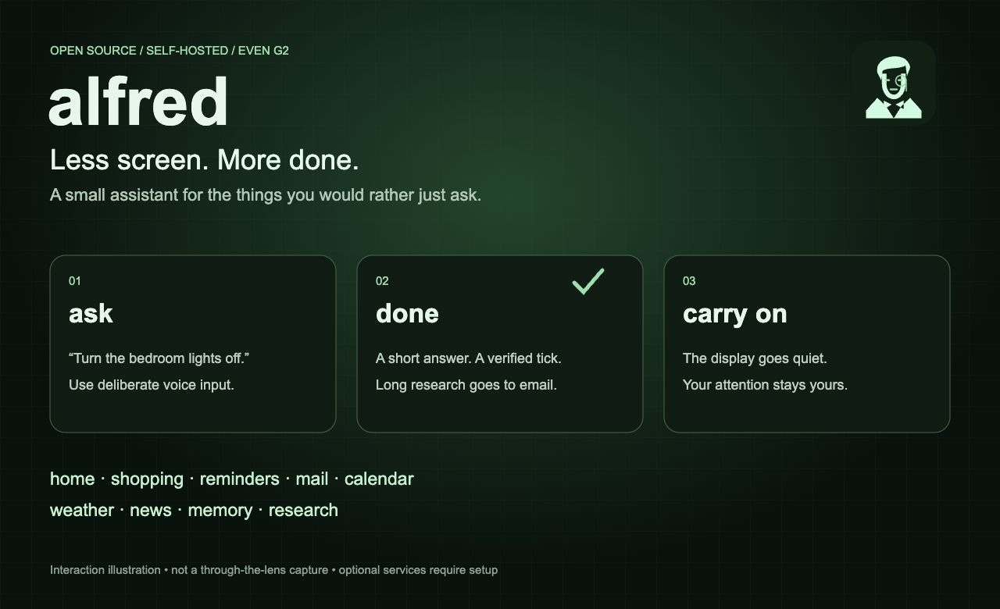
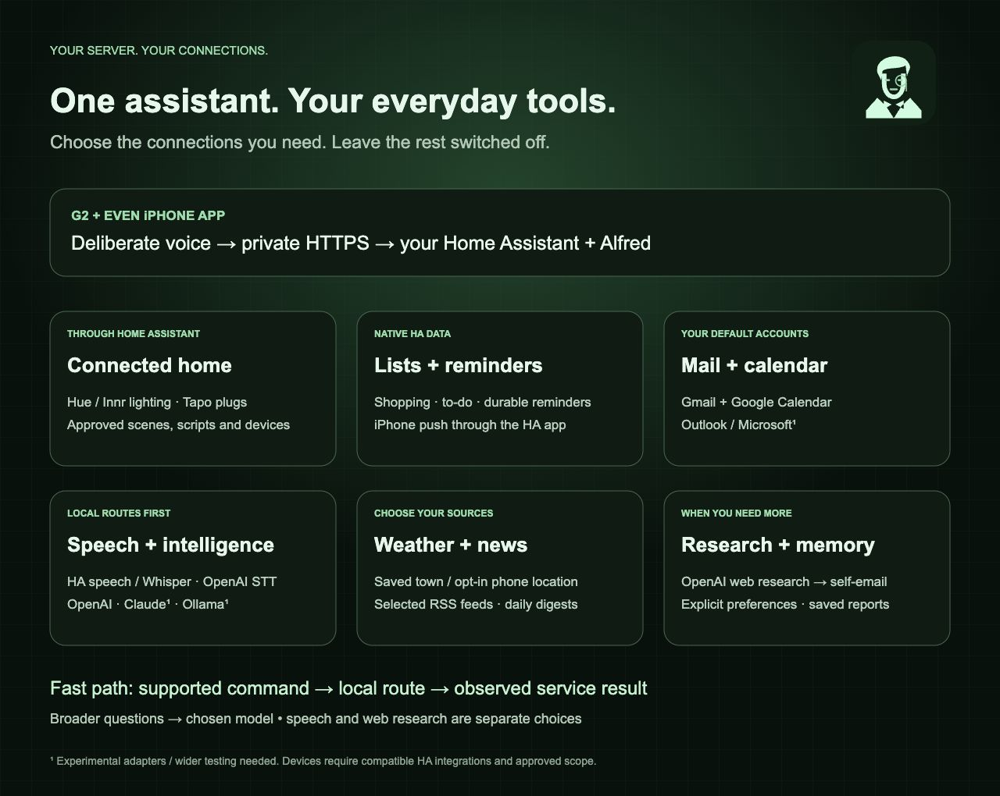
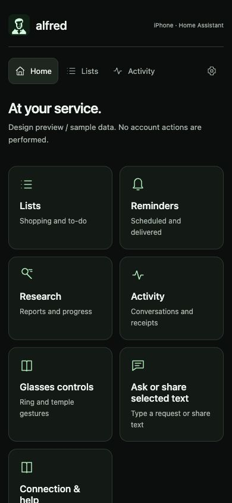
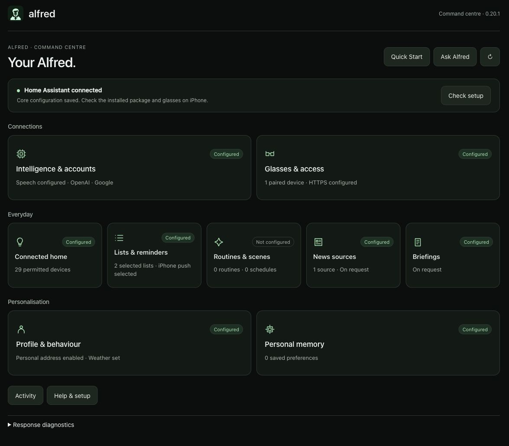
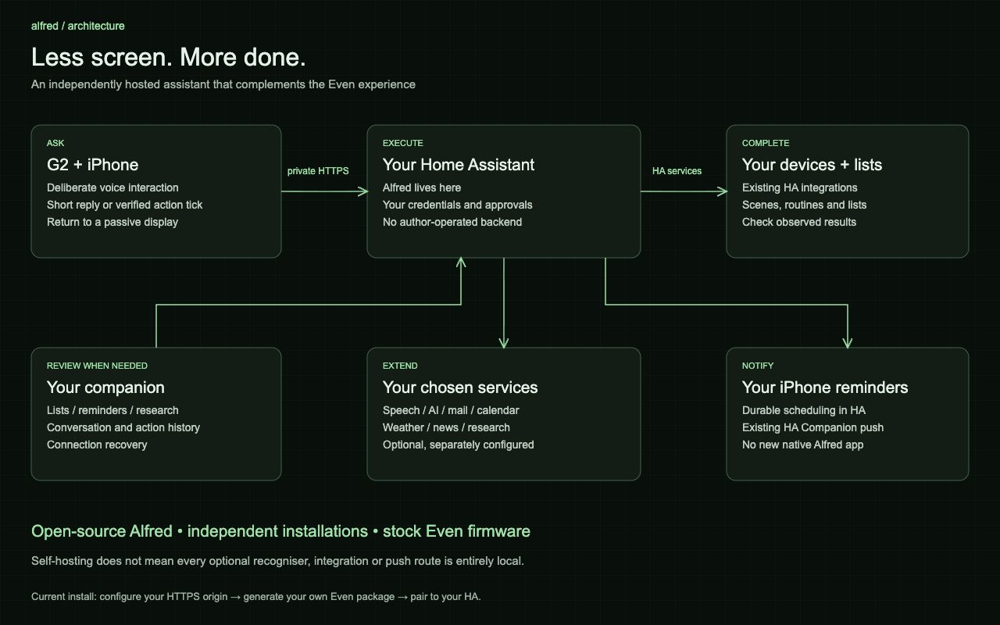

# alfred


A discreet English-butler assistant for **Even G2 and iPhone**, hosted in **your own Home Assistant**.

Less app switching, more “could you just…?” Ask about your day, adjust the lights, add dinner ingredients to a shopping list, set a reminder, or research a topic and have the findings emailed to you. Alfred gives you a short answer or a brief tick for completed supported actions, then lets the display go quiet.

The personality is a restrained English butler: helpful, a little dry, and customisable to your preferences. The aim is to keep your attention on what you're doing, with the glasses there when you need them.

**Open source · MIT licensed · independently self-hosted · iOS focused**

[GitHub](https://github.com/maxglynjones/alfred) · [Start from scratch](docs/setup/README.md) · [Feature examples](docs/FEATURES.md) · [Controls](docs/setup/CONTROLS.md) · [Developer guide](docs/development/README.md) · [Contribute](CONTRIBUTING.md)

> **Read before installing:** this is a community source project. The current glasses client needs a package generated for your own HTTPS Home Assistant address and installed through your own Even Hub developer application. It is not a universal, install-and-go Even Store download. [Why the package is specific to your server](docs/setup/EVEN.md).



_Original interaction illustration, not a through-the-lens screenshot. Optional services require your own setup._

## Why Alfred?

The G2's quiet display is a good place for a useful answer, rather than another endless screen. Alfred brings everyday tasks into one deliberate interaction instead of asking you to switch between separate apps for weather, lists, reminders and home controls.

The dashboard is optional. Speech starts with intentional input. Supported actions can finish with a brief tick; conversational replies expire after a reading-time budget. Longer answers and research can go to your email instead of becoming an essay on the glasses.

Alfred complements the official Even software. It uses stock firmware and the supported SDK, and does not require a purpose-built native Alfred iPhone application. Home Assistant supplies an existing home-integration ecosystem; Alfred brings that together with your chosen personal services.

Early firmware exploration was about direct activation and deeper device control. This release stays with stock firmware: installation does not involve flashing your glasses. It's an independent community project, built with extensive Codex assistance and hands-on integration and glasses testing.

## What can I do with it?

| Feature                     | Example                                                                              | What you configure                                                                       |
| --------------------------- | ------------------------------------------------------------------------------------ | ---------------------------------------------------------------------------------------- |
| Home status and control     | “Turn the bedroom lights on.” → “Set them to 40 percent.” → “Turn them back off.”    | HA device integrations, meaningful Areas/names and explicit Alfred permissions           |
| Lighting scenes and restore | “Save current bedroom lighting as a scene called Reading.”                           | Approved compatible lights; native HA scenes/scripts can also be discovered within scope |
| Shopping and to-do          | “Add ingredients for spaghetti bolognese for four to my shopping list.”                | Selected native HA to-do entities; clear removes items, not the entity                   |
| Scheduled reminders         | “Remind me to put the washing out in ten minutes.”                                   | Alfred's HA scheduler; optional HA iPhone app and notification target for push           |
| Mail and calendar           | “What's in my calendar tomorrow?” / “Show my unread emails.” → “Read the first one.” | Your Google or Microsoft OAuth connection and chosen default providers                   |
| Email to yourself           | “Email me a test message. Make up a short subject and body and send it.”             | A sending account and your profile self-email address                                    |
| Research and longer answers | “Research three facts about Windsor Castle using official sources.”                  | Search-capable provider; mail/self-email for delivered reports                           |
| Weather and news            | “What is the weather?” / “Show news.”                                                | Saved town or opt-in approximate phone location; selected RSS feeds                      |
| Personal memory             | “Remember that my favourite tea is Earl Grey.” → “What's my favourite tea?”          | Explicit saved memories; ask to show or forget them                                      |
| Conversation                | A short factual question or a broader request using configured tools                 | A chosen cloud/local conversation model; speech recognition is a separate choice         |
| Glanceable dashboard        | “Show my dashboard.”                                                                 | Optional weather/list data; batteries appear only when Even supplies valid readings      |
| Routines and briefings      | Invoke a configured routine or bring together the available parts of your day        | Approved actions and relevant accounts; advanced workflows remain experimental           |

A suggested recipe ingredient list uses the configured AI; plain list reads/writes have direct routes. Memories can give that AI context: save a favourite meal, then ask for ingredients for it later. They do not supply a built-in verified recipe database. “Show my memories” and “Forget …” keep those preferences under your control.

Follow-ups use bounded session references; ambiguity still needs clarification. A lamp connected through an on/off plug does not become colour-capable. Unsupported capabilities, unavailable services and uncertain action results must not turn into false success ticks.

For prerequisites, more advanced examples and feature-specific limits, see the [full feature guide](docs/FEATURES.md). Google, OpenAI and selected lighting/plug/list/push workflows have been exercised on the reference installation. Microsoft, Claude, alternative local models and broader device/routine combinations need independent validation.

## Choose your connections



_Explanatory artwork. HA is the core; optional connections are configured individually. Experimental adapters are labelled._

| Connection | Options | Status / boundaries |
| --- | --- | --- |
| Conversation | OpenAI, Claude, Ollama | OpenAI exercised; Claude and alternative local-model setups experimental |
| Speech recognition | HA speech such as Whisper, OpenAI transcription, compatible local speech endpoint | HA/OpenAI exercised; compatible custom services experimental; separate from conversation choice |
| Home | Your HA integrations and approved entities | Selected Hue-connected Innr lighting and Tapo plugs exercised; other devices need validation |
| Lists and reminders | HA to-do entities, Alfred's persisted scheduler, HA iPhone notification service | Reference list and immediate/scheduled push workflows exercised |
| Mail and calendar | Google / Microsoft, independently selected defaults | Google exercised; Microsoft/provider-specific variations experimental |
| Weather and news | Saved town or opt-in approximate phone location; selected RSS sources | Not a fixed developer location or BBC-only feed |
| Web research | Separate OpenAI search-capable connection and your self-email account | Research-to-email exercised; not implied by configuring Claude/Ollama alone |

Use only what you need. Ordinary commands don't require every account to be connected; a missing connection should explain the setup needed for that feature. [Provider setup](docs/setup/PROVIDERS.md) · [Home setup](docs/setup/HOME.md).

## Local routes for the everyday stuff

Supported commands use rules and local service operations before a conversational model. An optional tiny local interpreter can handle alternative wording; broader questions use the selected conversation provider. A direct route avoids model reasoning for a supported request, but cloud speech can still receive its audio if you choose a hosted recogniser.

Local speech recognition is available, but isn't necessarily faster. The reference installation currently uses hosted transcription after comparative testing. Speech recognition, command routing and general conversation are three separate stages, with separate settings.

| Historical development sample | Measured server time | What it does **not** measure |
| --- | --- | --- |
| Lighting status after direct routing | 4,457 ms before → 13 ms after | Complete ring-to-display interaction |
| Synthetic voice lighting-status requests with hosted transcription | 519 / 552 / 723 ms | Capture time, phone-to-server path or BLE rendering |
| Local Whisper tiny, English / int8 / beam size 1 | 1,832–2,037 ms warm; 4,013 ms cold | Accuracy across users, accents and room/device names |

These are small historical samples, not current-version performance guarantees. No reproducible tiny conversational-model throughput or battery-life benchmark is claimed. See the [measurement methods and evidence limits](docs/development/TECHNICAL-REFERENCE.md).

## A look at Alfred

### Companion



_Actual browser preview with sample data, not a physical iPhone or glasses capture._

This companion opens inside the Even app for occasional review: lists, reminders, research, conversation/action history and connection recovery. It isn't another dashboard you need to keep visiting. A separately paired phone browser also supports text requests when you aren't wearing the glasses. If a paired client is lost, revoke its access from the HA administrator controls.

### Home Assistant command centre



_A genuine configured reference installation, cropped to remove private details. New users start with empty accounts and choose the features they want._

Alfred appears in the HA sidebar. Its command centre manages feature tiles, connections, approved devices, readiness checks, guides and client pairing. It uses HA administrator authentication; daily glasses interactions use a scoped paired-client credential.

## How it fits together



The glasses display and microphone connect through the official Even iPhone app. Alfred's frontend runs in its WebView; the backend is a Python custom integration inside Home Assistant. A paired client credential authorises requests to your own server.

Home Assistant supplies the existing device integrations, Areas, native lists, scripts/automations, persistent host and iPhone notification service. Alfred adds command routing, assistant orchestration, display handling and personal-service adapters. It does not automatically support every HA integration or route every operation through MCP.

Node, pnpm and Vite are build/development tools, not a separate production Alfred server. The tested host is a Mac mini running HAOS in UTM; a Mac is not intrinsically required. Existing HA installations can be used, while other deployment combinations need validation.

[Technical architecture](docs/development/ARCHITECTURE.md) · [Editable diagrams](marketing/community/diagrams/README.md) · [Engineering decisions](docs/development/ENGINEERING.md)

## What do I need?

**Required:**

- Even G2, an iPhone and the official Even app, with the hardware paired.
- An always-available Home Assistant installation. HA hosts Alfred even if you only want basic AI.
- A valid HTTPS address reachable from the phone. The tested private remote route is Tailscale on the host and iPhone.
- Your own Even Hub developer access and registered application/package ID.
- A build computer with Git, Node 22 or 24, pnpm 10.18.3 and Python 3.12+.
- A configured speech recogniser for voice interaction.

**Optional:** R1 ring, a general AI provider/local model, smart-home integrations, native HA lists, mail/calendar accounts, search/news/weather, and the official HA iPhone app for push notifications.

Start with the smallest useful setup. There is no need to configure every connector. Missing features explain what they need; accounts and devices are not preconfigured to the developer's setup. Consumer ChatGPT/Claude subscriptions do not supply API access. Optional services, hardware and hosting have their own costs.

## Getting started

The [complete setup guide](docs/setup/README.md) covers tools, HA transfer, HTTPS, speech, your Even package, pairing and the first successful request.

1. **Install Alfred in HA.** Existing HA users skip host installation. New Mac users can follow the [Mac/UTM guide](docs/setup/MAC.md).
2. **Establish your HTTPS connection.** Follow [private remote access](docs/setup/REMOTE-ACCESS.md) and test it on iPhone cellular.
3. **Choose speech recognition.** Add general AI only if wanted; see [provider setup](docs/setup/PROVIDERS.md).
4. **Generate and install your package.** Use your exact origin and registered package ID; follow [Even installation](docs/setup/EVEN.md).
5. **Pair and test “What can you do?”** Then connect only the features you want.

A compact command reference, after installing the build tools:

```sh
# Clone the Alfred source.
git clone https://github.com/maxglynjones/alfred.git alfred
cd alfred
npm install --global pnpm@10.18.3
pnpm install --frozen-lockfile
pnpm pack:ha
```

Install the resulting `integrations/home-assistant/alfred-ha.zip` in HA as described in the setup guide. Once your HTTPS origin and Even application are ready:

```sh
pnpm build:self-hosted https://YOUR_HA_ORIGIN YOUR_REGISTERED_PACKAGE_ID
```

This generates your ignored `.local/packages/alfred-VERSION.ehpk`. It does not register an application, upload files or create a shared account. The portal's private/test installation workflow is distinct from developer QR loading and from public Store approval.

The [guide](docs/setup/README.md) includes expected results at each step, and the [recovery guide](docs/setup/OPERATIONS.md) explains updates, backups, troubleshooting and uninstall. Setup guides are also bundled locally in the companion and HA Help.

## Why isn't there one universal Even package?

Even Hub has two independent networking checks: the app's packaged destination whitelist and browser CORS. The documented whitelist requires exact full origins; arbitrary user-entered destinations and wildcards are not supported. Alfred handles server-side CORS separately, but a correct CORS response cannot grant a new destination permission.

Every user's HA address differs, so the current direct-to-user-server design uses an origin-specific package. This is an intentional trade-off for independent hosting, not proof that a universal package can never exist or that open-source publication is prohibited.

A shared application relay could provide one fixed origin, but would put another service between users and their homes. Alternative remote-access arrangements were considered too. The current release chooses independent hosting and Tailscale rather than requiring an Alfred-operated service; nobody depends on the author's Mac. [Simpler personalised packaging](docs/development/PACKAGING.md) is proposed; an officially approved, user-consented destination mechanism would be the preferred platform improvement. Neither is claimed as a shipped universal installer.

[Distribution details](docs/publishing/EVEN-STORE.md) · [Even networking documentation](https://hub.evenrealities.com/docs/build/networking)

## Privacy and independence

Each user runs their own installation and holds their own configuration, account credentials and backups. There is no compulsory Alfred account, author-operated backend or reliance on the author's computer.

Self-hosted does not mean every dependency is local. Tailscale normally prefers direct encrypted connections but can use encrypted transport relays and has hosted coordination. Cloud speech can receive audio even for a rule-handled home command; AI fallback can receive relevant request/context. Vendor integrations, remote iPhone push, mail, search and weather have separate external boundaries.

Provider keys/OAuth secrets are entered only in the HA-authenticated command centre and stored privately in HA. Installed clients receive scoped pairing credentials, not provider keys or HA administrator tokens. HA `.storage` is not encrypted per field: protect the host and backups. A custom integration is trusted code running inside HA Core.

[Tailscale direct/relay explanation](https://tailscale.com/docs/concepts/traffic-routing-through-tailscale) · [What stays local and what can leave](docs/setup/PRIVACY.md) · [Credential map](docs/setup/SECRETS.md) · [Security model](SECURITY.md)

## Everyday controls and phone surfaces

R1 is optional. On the reference setup, Alfred is first in the stock glasses menu and R1 long press opens Menu: hold, then one tap to launch.

| While Alfred is open | Control |
| --- | --- |
| Speak without a ring | Tap a temple, wait for the microphone, speak, then tap again to send |
| Hold to speak | Hold/release R1 or a temple when the native host delivers those events |
| Open dashboard | Say “Show my dashboard”; personal mode also uses left-temple double tap to show/hide |
| Return to passive | Personal mode: right-temple or R1 double tap; contextual menu: Hide display |
| Fallback / exit | Glasses contextual menu: Speak, Dashboard, Hide display, Close Alfred |

The new ring-free routes in 0.20.2 are regression-tested but need physical confirmation on installed hosts. Store mode retains Even's required exit behaviour; consult the [controls guide](docs/setup/CONTROLS.md) and verify your app/firmware. There is no always-listening wake word.

The optional dashboard, reply scrolling, dismissal and exit controls are documented in [Controls](docs/setup/CONTROLS.md). Replies have a deterministic reading-time budget, while a verified supported action normally displays a brief tick and clears.

The **Even companion** offers Home, Lists, Reminders, Research, Activity and Settings, including connection/device recovery. The **HA command centre** handles administrator setup, provider selection, approved devices, optional features and guides. They are web surfaces; no separate native Alfred iPhone app is required. Configured means settings exist, not that a live provider request succeeded.

## Current status and limitations

This is an independently developed, extensively AI-assisted community project, primarily tested on one **Mac mini M2 / 8 GB / UTM / HAOS / iPhone 15 Pro / G2 / R1** installation. OpenAI, Google, Hue-connected lighting, Tapo plugs, HA lists and iPhone push have been exercised there.

- Claude, Outlook, alternative Ollama models, Linux and AWS/Azure/GCP deployments are experimental until tested on the intended setup. The [cloud-host guide](docs/setup/CLOUD.md) is separate from the tested beginner path.
- R1 battery depends on status data supplied by the native host and is not consistently available. R1 health statistics are not exposed by the installed SDK. [Device diagnostics](docs/setup/DEVICES.md).
- The richer dashboard transfers bitmap tiles sequentially over BLE. It can take longer than native text; there is no atomic full-screen or stock-equivalent battery-life guarantee.
- iPhone reminders use HA's notification service. Alfred does not read arbitrary iOS notifications or personal WhatsApp history, nor promise background glasses delivery.
- No custom firmware, phone calling/CallKit, automatic stock-app launching or always-on wake word is included.
- HA's observed state is not a physical measurement. Email acceptance is not inbox delivery. Uncertain external writes are not blindly replayed.

The reviewed snapshot has **164 passing automated tests** across frontend, HA runtime and reminder fixtures. These are not proof of every device/account combination, a fresh-user installation or a complete security audit. Historical server-side measurements, missing current hardware benchmarks and cost assumptions are recorded in the [technical reference](docs/development/TECHNICAL-REFERENCE.md).

## Documentation map

| I want to…                                   | Read                                                                                                                                                  |
| -------------------------------------------- | ----------------------------------------------------------------------------------------------------------------------------------------------------- |
| Install from scratch                         | [Setup](docs/setup/README.md), [Mac host](docs/setup/MAC.md), [Even package](docs/setup/EVEN.md)                                                      |
| Connect my home, lists and push              | [Home guide](docs/setup/HOME.md)                                                                                                                      |
| Choose AI, speech, mail and calendar         | [Providers](docs/setup/PROVIDERS.md)                                                                                                                  |
| Understand controls and recover a connection | [Controls](docs/setup/CONTROLS.md), [Operations](docs/setup/OPERATIONS.md), [R1/device diagnostics](docs/setup/DEVICES.md)                            |
| Understand features and privacy              | [Features](docs/FEATURES.md), [Data boundaries](docs/setup/PRIVACY.md), [Security](SECURITY.md)                                                       |
| Understand the architecture and trade-offs   | [Architecture](docs/development/ARCHITECTURE.md), [Engineering](docs/development/ENGINEERING.md), [Evidence](docs/development/TECHNICAL-REFERENCE.md) |
| Develop or contribute                        | [Developer guide](docs/development/README.md), [Contributing](CONTRIBUTING.md)                                                                        |
| Explore future improvements                  | [Packaging proposal](docs/development/PACKAGING.md), [Even platform proposals](docs/development/EVEN-RECOMMENDATIONS.md)                              |

## Develop and contribute

Use Node **22 or 24**, pnpm **10.18.3** and Python **3.12+**:

```sh
pnpm install --frozen-lockfile
pnpm build
pnpm test
python3.12 -m venv .venv
.venv/bin/python -m pip install -r requirements-dev.txt
.venv/bin/python -B tests/ha-native-runtime.py
.venv/bin/python -B tests/ha-reminder-engine.py
pnpm check:public
```

`pnpm dev` serves a local preview; open `http://127.0.0.1:5173/?preview=1` for sample data without account/device actions. Production runs in HA. `pnpm pack:ha` builds its generic install archive; `pnpm pack` builds your origin-specific Even package after deployment configuration.

| Folder                                                       | Responsibility                                                                  |
| ------------------------------------------------------------ | ------------------------------------------------------------------------------- |
| `src/display`, `src/state`, `src/audio`                      | Glasses rendering, gestures, batteries, pairing and deliberate capture          |
| `src/main.ts`, `src/phone-navigation.ts`, `src/companion.ts` | Session orchestration and companion views                                       |
| `public/studio`                                              | Shared web design, icons, command-centre enhancement and readiness presentation |
| `integrations/home-assistant/custom_components/alfred`       | HA backend, actions, providers, reminders and admin panel                       |
| `config`                                                     | Product defaults, preferences, display power and command-routing settings       |
| `scripts`, `tests`, `examples`                               | Builds, checks, regressions and deployment examples                             |
| `docs`, `marketing`                                          | Guides, architecture, diagrams and public visual assets                         |

Fresh-install feedback, good bug reports, accessibility improvements and device testing are just as useful as code. The [community G2 resource collection](https://github.com/pangoleen/awesome-even-realities-g2) is useful background for developers exploring the platform. Include relevant versions, a non-sensitive example request, expected behaviour and what happened. Use disposable test data; do not publish private transcripts, tokens, inbox content, home addresses or recovery exports. Experimental support should stay labelled until validated. See [Contributing](CONTRIBUTING.md) and the [release checklist](docs/publishing/RELEASE-CHECKLIST.md).

## Licence

Alfred source is **MIT licensed**. The bundled Space Grotesk font retains its SIL Open Font License; other bundled dependencies retain their licences. [Third-party notices](THIRD-PARTY-NOTICES.md).

Alfred is independent of Even Realities, Apple, Home Assistant and the model providers. Their software, services and terms are separate from Alfred's open-source licence.
