# Architecture and boundaries

```mermaid
flowchart LR
  G[G2 display / microphone] <-->|BLE via Even app| E[Alfred in Even iPhone WebView]
  Ring[Optional R1 input] -->|BLE via Even app| E
  P[Paired phone browser] <--> H[Alfred HA endpoints]
  E <-->|Private HTTPS + client token| H
  A[HA authenticated admin panel] --> H
  H --> R[Rules and contextual command resolution]
  R --> D[Approved HA devices and lists]
  R --> M[Optional local interpreter]
  R --> C[Selected cloud / local conversational model]
  H --> S[HA persistent reminder scheduler]
  S --> I[HA Companion iPhone push]
  H --> O[OAuth mail / calendar providers]
```

## Frontend

`src/main.ts` coordinates capture/session/mode state. `SmoothDisplay` owns a serial bridge queue, skips unchanged writes and replaces stale queued work. Full-screen graphic dashboard tiles cannot be atomically committed by the current SDK. Native reply text is kept separate from opaque bitmap containers to prevent overlap. `reply-layout.ts` defines wrapping/paging; `src/state/conversation.ts` computes deterministic reading time. Gesture decoding and supplied device battery normalization are separate state modules. Never invent a battery value when a source cannot identify it.

The admin panel is an HA custom element using HA login. `operations.js` enhances existing feature forms with tiles and nested modals while preserving handlers. `quick-start.js` is static onboarding copy. The paired phone companion is a separate client surface, not an alternative administrator credential.

## Backend

- `runtime.py`: loads HA Store/defaults, client operations, bounded history, pairing/rate limits, scheduled lifecycle and receipts.
- `web.py`: authenticated admin API, paired-client API, OAuth callbacks, input/config validation and origin policy.
- `commands.py`: deterministic/optional tiny interpretation, target resolution and mutation journals.
- `local_ops.py`: common lists/mail/calendar/news/memory/scene operations and short-lived device-scoped references.
- `assistant.py` + `tool_contracts.json`: bounded conversational tool loop, validated provider actions and untrusted-content boundaries.
- `home.py`: current entity discovery/permissions, capability-aware controls, readback verification, selected HA to-do lists, light gamut/snapshot/scene handling.
- `providers.py`: asynchronous account/model/weather/news requests, OAuth refresh locking, adapter protocols and document/MIME serialization.
- `weather.py`, `prompts.py`: location normalization and readable persona/execution policy.
- `email_format.py`: escaped limited Markdown, branded HTML/plain alternatives and embedded logo.
- `calendar_rules.py`: bounded scheduling/recurrence normalization.
- `media.py`: HA speech recognition and explicitly selected photo inspection. No live-calling implementation is shipped.
- `__init__.py`: HA registration, persistent reminder engine, notification dispatch and cleanup.
- `config_flow.py`, `conversation.py`, `experiences.py`: HA configuration/Assist integration, routines/briefings/knowledge and scoped workflows.

## Execution contract

User input → direct command where possible → approved current target resolution → service call → observed receipt → display/delivery. An LLM proposes parameters; it cannot grant access. Unsupported lighting capabilities may be skipped when requested compatible fixtures verify. Removed targets are not silently mapped to somebody else's device. Read questions never receive action ticks.

Explicit email/calendar/config actions use a validated pending action. Clear requests execute automatically unless the user enabled review; ambiguity/sensitive restrictions still require clarification. Uncertain external sends are not automatically retried. Calendar/mail/web text is untrusted and cannot supply authorisation; explicit deletion uses current selected IDs plus the user's own direct request.

The system is designed for one independently self-hosted household. A developer-operated relay, compulsory Alfred account or multi-tenant service is not required and is outside the product direction. HA administrator access and custom integration installation are trusted boundaries. Optional model/provider services have their own privileges/network exposure and are outside HA's process.

[Editable diagrams](../../marketing/community/diagrams/README.md) separate transport, CORS/authentication and reminder delivery. [Privacy boundaries](../setup/PRIVACY.md) distinguish self-hosted execution from cloud speech/AI and optional iPhone push. MCP is not a universal transport for all operations: native HA bindings handle home/list actions; Google/Microsoft/search adapters remain separate.

On the reference VM setup, the HTTPS connection terminates in Tailscale Serve on the user's Mac, then TCP-forwards HTTP to the private HA VM address. The diagrams' logical HA endpoint is therefore not a claim that HA Core itself terminates TLS. No Tailscale Funnel/public relay endpoint is used. Same-host deployments can use a different documented Serve mode; validate the chosen boundary independently.
